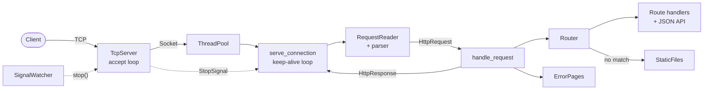

# Architecture

This document explains how `cpp-http-server` is put together: the
components, how a request travels through them, which thread runs what, and
the design decisions behind them. For usage, see the [README](../README.md).

## Overview

The server is a single process with three kinds of threads:

- the **main thread** runs the accept loop,
- a fixed pool of **worker threads** serves connections,
- one **signal thread** waits for SIGINT/SIGTERM.

All server code lives in the `http_core` static library (`include/` +
`src/`, namespace `http`). `src/main.cpp` only wires the pieces together:
it loads the configuration, registers the routes and starts the server.
The unit tests link against the same library.



## Components

The library is layered: each layer only depends on the ones below it.

| Layer          | Header(s)                                   | Responsibility |
|----------------|---------------------------------------------|----------------|
| Sockets        | `socket.hpp`, `stop_signal.hpp`             | Move-only RAII `Socket` over a POSIX descriptor (bind, listen, accept, timeouts, `send_all`); `StopSignal`, a pollable one-shot stop flag |
| Server         | `tcp_server.hpp`, `thread_pool.hpp`, `signal_watcher.hpp` | Accept loop, worker threads, signal handling |
| HTTP protocol  | `request_reader.hpp`, `http_request.hpp`, `url.hpp`, `http_response.hpp`, `status.hpp`, `connection.hpp` | Reading and parsing requests, building and serializing responses, the per-connection keep-alive loop |
| Application    | `router.hpp`, `static_files.hpp`, `mime.hpp`, `error_pages.hpp`, `json.hpp`, `demo_api.hpp` | Mapping requests to handlers, serving files, error pages, JSON |
| Infrastructure | `config.hpp`, `cli.hpp`, `logger.hpp`, `version.hpp` | Configuration file, command line, logging |

### Sockets

`Socket` owns one file descriptor and closes it in its destructor. It can be
moved but not copied, so ownership of a connection is always explicit: the
accept loop moves the accepted `Socket` into the task that serves it, and the
connection is closed when that task finishes, whatever path it takes
(normal return, timeout, exception). All system call failures are reported
as `std::system_error`.

`StopSignal` is a thread-safe flag backed by a socket pair. `request()` sets
an atomic and writes one byte, which makes `wait_fd()` readable for good.
`wait_readable(socket, timeout, stop)` uses `poll()` on both descriptors, so
a thread blocked waiting for a client wakes up immediately on shutdown
instead of sitting out its timeout.

### Server

`TcpServer` binds and listens, then runs the accept loop on the calling
thread. Every accepted socket gets the client timeout
(`SO_RCVTIMEO`/`SO_SNDTIMEO`) and is handed to the `ThreadPool` together
with the connection handler. An atomic counter tracks the connections that
are queued or running, which the shutdown log uses.

`ThreadPool` has a fixed number of workers (default: one per CPU core)
sharing a FIFO queue guarded by a mutex and a condition variable. `post()`
queues fire-and-forget work (escaping exceptions are logged, not fatal);
`submit()` returns a `std::future`. `shutdown()` stops accepting tasks,
drains the queue and joins the workers.

`SignalWatcher` blocks SIGINT and SIGTERM with `pthread_sigmask` before any
other thread is created, so every thread inherits the blocked mask, and
receives them with `sigwait()` on its own thread. The callback is therefore
ordinary code that may log and take locks, unlike a classic signal handler.

### HTTP protocol

`RequestReader` reads from one connection into a buffer until it has a full
request head (`\r\n\r\n`), parses it, then reads exactly `Content-Length`
body bytes. Anything received beyond the current request stays in the buffer
for the next call, which is what makes pipelining work. Head and body sizes
are limited (`RequestLimits`, 8 KiB and 1 MiB by default).

The parser (`parse_request_head`) validates the request line, the HTTP
version (`HTTP/1.0` or `HTTP/1.1`) and every header line, lower-cases
header names, and splits the target into a percent-decoded `path` and the
decoded `query_params` (`url.hpp`). Any violation throws `ParseError`
(`RequestTooLarge` for size limits), which the connection turns into a
`400` or `413`.

`HttpResponse` is a small value type: status, ordered headers and body.
`serialize()` adds `Content-Length`, `Date` and `Server` and produces the
wire format; for `HEAD` it omits the body but keeps the length. Responses
created with `HttpResponse::error()` are marked as *generated errors* so the
error page renderer can recognise them later.

`serve_connection()` is the per-connection loop. It reads a request, calls
the request handler, decides whether the connection stays open, sets the
`Connection`/`Keep-Alive` headers and sends the response, until the client
closes, goes idle, sends a bad request, reaches `max_requests`, or the
server shuts down.

### Application

`Router` keeps exact routes in a `std::map<path, method → handler>` and
parameterised routes (`/users/:id`) as pre-compiled segment lists tried in
registration order. Exact routes always win. A path that matches but has no
handler for the method yields `405` with a sorted `Allow` header; `HEAD`
falls back to the `GET` handler; an unknown path goes to the fallback, which
the demo sets to `StaticFiles`.

`StaticFiles` maps the decoded URL path into the document root. It rejects
`..` segments and hidden files before touching the file system, then
canonicalises the result and checks that it is still inside the
(canonicalised) root, which also defeats symlinks pointing elsewhere.
Directories serve `index.html`, or redirect to the trailing-slash form.

`ErrorPages` loads `errors/<status>.html` once at startup. After routing,
`apply()` replaces the body of a generated error with the rendered template
if the client accepts `text/html`; other clients keep the plain-text body.

`Json` is a variant-based value type with an insertion-ordered object, a
recursive-descent parser (depth-limited to 64) and a serializer.
`demo_api.hpp` builds the `/api/todos` endpoints on top of it, with a
`TodoStore` protected by a mutex because handlers run on many workers.

### Infrastructure

`ServerConfig` is a plain struct with defaults. It is filled in layers:
`parse_config()`/`load_config()` (the `key = value` file), the `LOG_LEVEL`
environment variable, then `apply_cli()` with the parsed `CliOptions`. Each
layer only overrides what it actually sets. Errors carry the file name and
line number.

`Logger` is a process-wide singleton. Each call formats the whole line
first and then writes it under a mutex, so lines from different workers
never interleave. `DEBUG`/`INFO` go to stdout, `WARN`/`ERROR` to stderr.

## Life of a request

Following `GET /users/42?tab=posts HTTP/1.1` from a browser:

1. **Accept.** The main thread is blocked in `wait_readable()` on the
   listening socket and the stop signal. The connection arrives,
   `accept()` returns a `Socket`, the client timeout is set on it and it is
   moved into a task posted to the `ThreadPool`.
2. **Read.** A worker runs `serve_connection()`. `RequestReader` reads
   chunks until the head is complete, then the body (none here).
3. **Parse.** The head becomes an `HttpRequest`: method `Get`, path
   `/users/42`, query param `tab = posts`, lower-cased headers.
4. **Route.** `handle_request()` (in `main.cpp`) calls `Router::route()`.
   No exact route matches, the pattern `/users/:id` does, so the handler
   runs with `param("id") == "42"`.
5. **Errors.** Had the handler thrown, `handle_request()` would have caught
   it and produced a generated `500`. `ErrorPages::apply()` then turns
   generated errors into HTML for browsers.
6. **Log.** One access log line is written:
   `127.0.0.1:51234 GET /users/42?tab=posts -> 200 (9 B, 0.05 ms)`.
7. **Respond.** `serve_connection()` sets `Connection: keep-alive` and
   `Keep-Alive: timeout=5, max=99`, serializes the response and sends it
   with `send_all()`.
8. **Next request.** The loop waits for the next request on the same
   connection with the shorter keep-alive idle timeout. When the client
   stops sending, the loop ends, the task returns, the `Socket` destructor
   closes the descriptor and the worker picks up the next connection.

## Threading model

| Object                          | Shared by           | Synchronisation |
|---------------------------------|---------------------|-----------------|
| `Router`, `StaticFiles`, `ErrorPages`, `ServerConfig` | all workers | none needed: built before the server starts, read-only (`const`) afterwards |
| `TodoStore`                     | all workers         | `std::mutex` inside the store |
| `Logger`                        | every thread        | `std::mutex` around each write |
| `ThreadPool` queue              | main thread, workers | mutex + condition variable |
| `StopSignal`, connection counter | every thread       | atomics (+ the socket pair for waking pollers) |
| `Socket` of a connection        | one worker only     | ownership is moved, never shared |

A connection is owned by exactly one worker for its whole life, so the
protocol code needs no locks at all. The trade-off is that every open
connection occupies a worker: a pool of N threads serves at most N clients
at the same time. Socket timeouts (10 s for a request, 5 s idle between
keep-alive requests) bound how long a slow or idle client can hold a
worker.

## Graceful shutdown

```text
signal thread          main thread               workers
─────────────          ───────────               ───────
sigwait() → SIGINT
server.stop() ───────▶ wait_readable() wakes
                       close listener            idle connections wake → close
                       serve() returns           busy ones finish, reply with
                       pool.shutdown() ◀──────── "Connection: close", return
                       log "server stopped", exit 0
```

`main.cpp` declares the objects in dependency order (static files, to-do
store, router, error pages, server, signal watcher, pool), so destruction runs the other
way round: the pool is drained before anything a handler uses is destroyed.
A second signal calls `std::_Exit(128 + signal)` for an immediate exit.

## Error handling

- **System calls** throw `std::system_error`. In a connection this ends the
  connection (logged); during startup it is fatal (`fatal: ...`, exit `1`).
- **Malformed requests** throw `ParseError` / `RequestTooLarge` inside the
  reader; the connection answers `400` / `413` and closes.
- **Handler exceptions** are caught per request in `handle_request()` and
  become a `500`; the connection stays usable.
- **Configuration and command-line errors** are reported before the server
  starts (`ConfigError` with file and line, `CliError` with exit status `2`).
- **Pool tasks** that throw are logged, so a bug never kills a worker.

## Design decisions

- **Blocking sockets + a thread pool** instead of `epoll`/`kqueue`. The code
  for one connection reads top to bottom like the protocol itself, which
  suits a learning project; the cost is one worker per open connection.
- **RAII everywhere.** Sockets, threads and locks are owned by objects, so
  every early return and exception cleans up correctly.
- **Value types for HTTP messages.** `HttpRequest` and `HttpResponse` are
  plain data that can be built and inspected in tests without a socket.
- **Errors marked, rendered late.** Handlers return `HttpResponse::error()`
  without knowing about HTML; content negotiation happens in one place.
- **Immutable after startup.** Shared state is fixed before `serve()`
  starts, which removes most locking instead of adding it.
- **No dependencies.** Only POSIX and the C++17 standard library, including
  the JSON support and the test framework.

## Limitations

These are known and intentional for the scope of the project:

- no TLS (put a reverse proxy such as nginx in front for HTTPS),
- no `Transfer-Encoding: chunked` (chunked request bodies are rejected
  with `400`, so clients must send `Content-Length`; responses always carry
  a length),
- IPv4 only,
- files are read into memory in one piece (fine for a demo site, not for
  large downloads),
- no caching headers (`ETag`, `Last-Modified`) or range requests.

## Testing

- `tests/` holds unit tests for the parser, request reader, router, URL
  decoding, JSON and the demo API, using the small framework in
  `tests/test_framework.hpp` (`./build/unit_tests` or `ctest`).
- `scripts/smoke_test.sh` starts the real binary and checks it end to end
  with `curl`, including a clean SIGINT shutdown.
- GitHub Actions builds with GCC and Clang on Linux and Apple Clang on
  macOS, with warnings as errors, and runs both.
